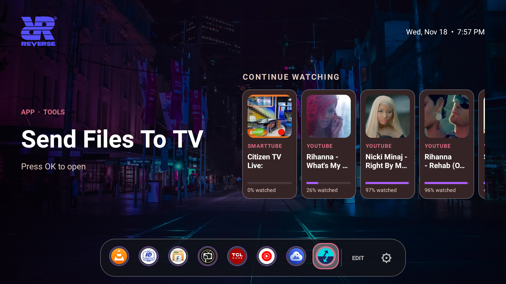
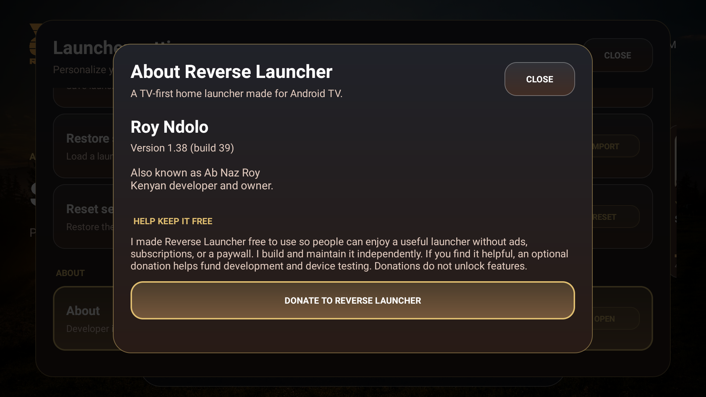

# Reverse Launcher

Reverse Launcher is a TV-first Android home launcher. This public repository contains user-facing release information and signed APKs; the application source code is not published here.

## Download and install

Download the signed APK from the [latest release](https://github.com/abnazroy/reverselauncher-releases/releases/latest), then open it on your Android TV or phone and follow Android's installation prompts. If Android asks, allow the file manager or browser you used to install apps. Select Reverse Launcher as the Home app when prompted.

## Enable Home redirect

In Reverse Launcher, open **Settings > Access Permissions > Make default home**. In Android TV Settings, open **Accessibility** and enable both the system Accessibility switch and **Reverse Launcher home redirect**. Both must be active for Home redirect to work. Some TVs leave the service selected while system Accessibility is off; if Reverse Launcher reports **System off**, enable the system switch as well. The service only detects supported TV Home launcher windows and cannot read screen content.

## Enable Continue Watching

On Android TV, open **Settings > Apps > Special app access > Notification access** (sometimes called **Notification listener access**) > **Reverse Launcher** > **Allow**.

This special access is different from **Settings > Apps > Reverse Launcher > Notifications**. The app-info Notifications switch controls notifications shown by the launcher; Notification Access allows Continue Watching to read media-session details from supported apps. Some TV firmware does not expose a direct settings shortcut, so use the manual path above.

## Enable Home redirect

Home redirect requires Android's system Accessibility switch and the Reverse Launcher service to both be active. A TV can still list the service while system Accessibility is off; in that state, Home redirect will not run.

## Screenshots

## Releases

See the [release history](https://github.com/abnazroy/reverselauncher-releases/releases) for APK downloads and version notes.
